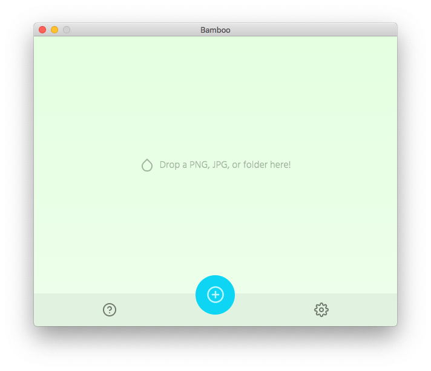

<p align="center">
  
</p>
<h1 align="center">Bamboo</h1>
<p align="center">A cross-platform TinyPNG client 🌱🎍</p>

Bamboo uses your [TinyPNG](https://tinypng.com/) API key to compress local PNG and JPEG files. Drop a file or a one-level folder, or add images with the plus button. Each image is uploaded to TinyPNG, the compressed result replaces the original, and the previous file is moved to the trash. Get an [API key](https://tinypng.com/developers) to use it.

The cog in the toolbar opens settings, where the API key is saved. About has a View Source button that opens [github.com/TomVarga/bamboo](https://github.com/TomVarga/bamboo).

Originally written by Chris Anselmo. Version 2.0.0 is a Rust rewrite by Tamás Varga and Grok.

<p align="center">
  
</p>

# Install on macOS

```
./scripts/macos-dmg.sh
```

Open `dist/Bamboo-2.0.0.dmg` and drag Bamboo into Applications. The disk image is built for the Mac you run the script on.

# Development

```
cargo run
```

A release binary is written to `target/release/bamboo`:

```
cargo build --release
```

The API key is stored in the app config directory (`~/Library/Application Support/bamboo/settings.json` on macOS).

# License
MIT

Bamboo is not affiliated with nor endorsed by Tinify/TinyPNG/TinyJPG.
